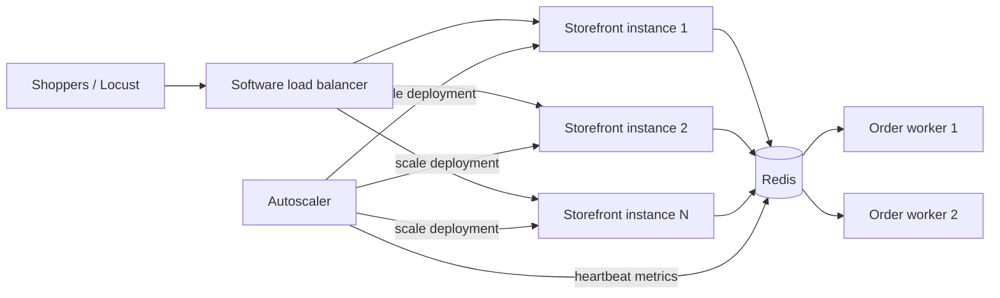
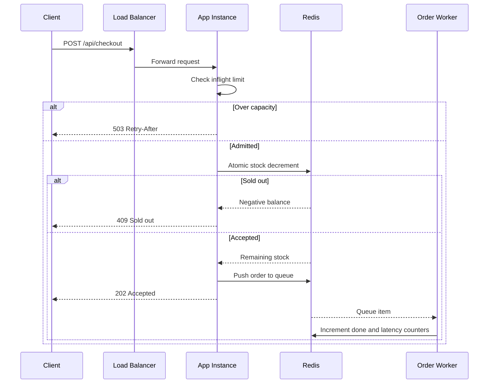
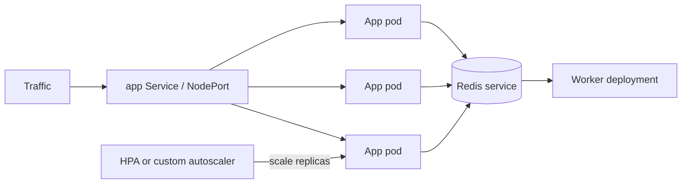
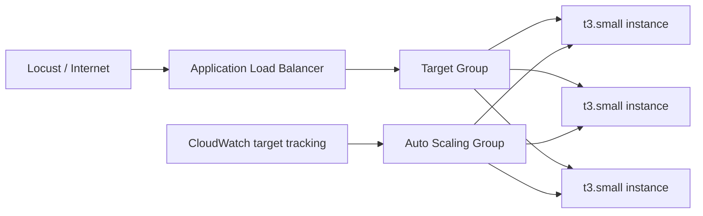

# Big Billion Days Scalability System Design

## 1. Purpose

This project demonstrates how an e-commerce storefront behaves under a traffic spike resembling a Big Billion Days event. It models the three central design goals of the case study:

- absorb a traffic increase of approximately 5x normal load;
- scale application capacity quickly while avoiding permanent peak-sized provisioning; and
- keep shopping responses available and prevent overselling during a flash sale.

The implementation is a reference system for learning and load-testing. It is not a complete Flipkart production architecture.

## 2. Goals and constraints

### Functional goals

- Browse products and search for deals.
- Add items to a cart.
- Submit checkout requests.
- Process accepted orders asynchronously.
- Return health and instance-identification information.
- Apply load shedding when an instance is overloaded.

### Non-functional goals

- horizontal scaling;
- high availability across multiple instances or pods;
- bounded queue and request pressure;
- fast scale-out and conservative scale-in;
- observable latency, throughput, failures and cost; and
- fair comparison of static, reactive and pre-warmed capacity.

### Constraints

- Redis is shared state for cache, stock, heartbeats and the order queue.
- AWS mode intentionally uses process-local memory for stock and cache, so it is an exercise deployment rather than a production-consistent shared data model.
- Service capacity is simulated with per-instance concurrency and service delay. CPU mode is used only for AWS experiments.
- Boot delay is simulated so the effect of cold capacity is visible.
- The load generator, load balancer and application may run on the same machine in local experiments.

## 3. Logical architecture



The system is divided into five layers:

1. **Load generation** creates a BBD-shaped ramp: warm-up, 5x ramp, peak hold, ramp-down and tail.
2. **Ingress/load balancing** distributes traffic over currently healthy application instances.
3. **Storefront tier** handles synchronous browsing and cart operations and admits checkout requests.
4. **Redis-backed state tier** supplies caching, stock counters, heartbeats, queue storage and queue metrics.
5. **Control/worker tier** scales the storefront tier and processes accepted orders.

## 4. Core components

| Component | Responsibility | Scale behavior |
|---|---|---|
| FastAPI storefront | Product, search, cart and checkout APIs | Stateless; horizontally replicated |
| Redis | Cache, stock counters, heartbeats and order queue | Shared backing state |
| Order workers | Dequeue and process accepted checkout orders | Scale independently |
| Load balancer | Route traffic only to healthy, ready instances | Docker/nginx, dev LB or AWS ALB |
| Autoscaler | Measure pressure and change desired application capacity | Process, Docker, Kubernetes or AWS ASG |
| Locust | Apply and measure mixed BBD-shaped traffic | Client-side load generator |
| Experiment runner | Collect timelines, plots and cost | Offline analysis |

### Storefront

The storefront exposes:

- `GET /health` for readiness;
- `GET /` and `GET /status` for basic availability;
- `GET /api/products` for cache-aside product browsing;
- `GET /api/search` for a simulated expensive search;
- `POST /api/cart` for cart state;
- `POST /api/checkout` for asynchronous order admission.

Each instance has a bounded concurrency semaphore. This makes capacity independent of the host CPU and allows experiments to use the same application logic locally and in containers.

### Cache

Product listings use cache-aside behavior:

1. read `products:<page>` from Redis;
2. return the cached value on a hit;
3. simulate the service/DB cost on a miss;
4. write the result with a 30-second TTL.

Cache hits and misses are instrumented with the `X-Cache` response header.

### Checkout

Checkout is asynchronous:

1. perform a lightweight application action;
2. atomically decrement the Redis stock key;
3. roll back the stock decrement if the item is sold out;
4. reject with 503 if the order queue is full;
5. push the accepted order to Redis; and
6. return `202 Accepted` with an order identifier.

The worker removes orders with `BLPOP`, simulates fulfilment work and records completed-order and processing-latency metrics.

## 5. Request flow



## 6. Deployment architectures

### 6.1 Local process deployment

The load-balancing process discovers app instances through Redis heartbeat keys. It uses least-in-flight routing and connection pooling. The autoscaler starts or terminates uvicorn processes.

This mode is useful for rapid, repeatable testing on a workstation.

### 6.2 Docker Compose deployment

Docker Compose runs Redis, app replicas, workers and nginx. Docker DNS lets nginx discover app replicas dynamically. The autoscaler changes the `app` service replica count.

Scale-in should remove an instance only after its heartbeat stops. Kubernetes and AWS additionally use readiness and deregistration safeguards.

### 6.3 Kubernetes deployment



Kubernetes provides:

- readiness probes;
- a rolling update strategy;
- a pre-stop delay for graceful draining;
- replica placement and restart behavior;
- kube-proxy load distribution; and
- optional CPU-based HPA.

The custom autoscaler is the primary exercise controller because CPU does not represent bounded app-slot utilization. In production, the same application-metric policy could be implemented by a custom Prometheus metric, HPA adapter or KEDA.

### 6.4 AWS deployment



Terraform creates:

- one ALB and HTTP listener;
- one target group with `/health` checks;
- an EC2 launch template;
- a 1-to-4 instance Auto Scaling Group;
- a 50% average-CPU target-tracking policy;
- security groups; and
- a CloudWatch scaling dashboard.

The EC2 launch template installs and runs the container with process-local cache and stock state.

## 7. Autoscaling design

### Reactive application-metric policy

Every instance publishes a heartbeat containing:

- utilization;
- requests per second;
- inflight request count;
- shed count; and
- a heartbeat timestamp.

The control loop computes an average utilization and inflight pressure:

```text
pressure = max(
    average_utilization,
    average_inflight / (concurrency x 4)
)

desired = ceil(ready_instances x smoothed_pressure / target_pressure)
```

The policy:

- evaluates every 5 seconds;
- scales out immediately;
- scales in gently after a 15-second cooldown;
- limits scale-out to double the launched fleet or launched + 4;
- enforces a configurable minimum and maximum; and
- charges for launched instance-seconds, including simulated boot time.

The cap prevents a transient queue from producing an unrealistic fleet while a booting instance has not yet become ready.

### Static baselines

- **static-low:** 4 instances, representing normal-traffic sizing.
- **static-peak:** 12 instances, representing all-day peak sizing.
- **static-8:** 8 instances, representing a fleet close to the measured peak capacity.

### Pre-warming

The pre-warm policy raises the minimum capacity before the sale window and then uses the reactive policy. This models advance capacity planning and cold-cache mitigation.

### AWS target tracking

AWS uses ASG average CPU with a 50% target. It provides no custom queue or slot metric, but is suitable for a real cloud deliverable because CPU in AWS mode is made to track shopper load.

The AWS policy includes:

- 180-second health-check grace period;
- 120-second default instance warmup;
- deregistration delay;
- 1-minute metrics; and
- an optional suspension of AZ rebalancing.

### Kubernetes HPA

The included HPA targets 50% CPU utilization with 2 minimum and 6 maximum replicas. Its scale-up policy is immediate and its scale-down policy has a 5-minute stabilization window.

## 8. Resilience and overload behavior

### Load shedding

An instance rejects requests with `503` and `Retry-After: 1` when it has reached the configured inflight limit. This bounds latency and protects the remainder of the fleet.

### Queue backpressure

Checkout rejects with `503` before an order is accepted when the Redis queue exceeds 20,000 entries.

### Atomic stock

Stock is decremented atomically, preventing simultaneous checkouts from overselling. A rejected stock decrement is reversed.

### Readiness and draining

- Kubernetes pods expose `/health` through a readiness probe.
- Kubernetes applies a pre-stop delay and termination grace period.
- nginx retries another upstream for connection or timeout failures.
- AWS uses ALB health checks and target deregistration.
- Docker/Kubernetes readiness prevents booting replicas from receiving traffic.

### Partial failure assumptions

Redis failure is not implemented as a separate fallback tier. In local and Docker modes Redis is a hard dependency for cache, stock and heartbeats. Production should use Redis availability management or a managed highly available cache and replicate stock state across AZs.

## 9. Data model

The exercise uses Redis keys rather than a relational database:

| Key pattern | Type | Purpose |
|---|---|---|
| `products:<page>` | JSON string | Product cache |
| `cart:<user>` | JSON string | Shopping cart |
| `stock:<sku>` | integer | Atomic inventory |
| `orders` | list | Pending checkout queue |
| `orders:done` | counter | Completed worker count |
| `orders:lat` | list | Recent queue-processing latency |
| `inst:<id>` | JSON string with TTL | Instance heartbeat and metrics |

## 10. Observability

The system records:

- offered and served request rate;
- p50, p95 and p99 latency;
- HTTP failures;
- ready and launched instance count;
- average utilization and inflight pressure;
- Redis queue depth;
- completed orders;
- scaling activity; and
- instance-seconds and estimated cost.

AWS adds CloudWatch widgets for:

- in-service versus desired instances;
- CPU against the 50% target;
- ALB p95 and average response time; and
- ALB requests per minute.

## 11. Capacity model

An instance has two concurrent slots by default. A heavy request consumes 250 ms in local simulation. With a mixed workload:

- one instance serves roughly 30 requests per second;
- a 5x normal profile requires roughly 8 to 12 instances at the peak;
- static-low capacity cannot absorb the 5x profile; and
- excess capacity reduces queueing and head-of-line blocking but has diminishing returns.

The steady-state sweep shows the knee around 5 to 6 instances for 150 requests per second. The actual number varies with service delay, concurrency and work mode.

## 12. Cost model

Cost is calculated as:

```text
cost = sum over elapsed time of launched_instances
       x assumed_hourly_instance_price / 3600
```

The default assumed price is USD 0.0208 per EC2-like instance-hour. AWS compute cost must also consider the real account price and ALB cost.

Cost should be compared with:

- average launched instances;
- median and worst-case p95 latency;
- failed-request percentage;
- scale-out delay; and
- tail traffic and cooldown behavior.

## 13. Scalability trade-offs

| Strategy | Advantages | Trade-offs |
|---|---|---|
| Static low | Low cost during normal load | Saturation and shedding during spikes |
| Static peak | Lowest scale-out risk | Wasteful idle capacity |
| Reactive | Low idle cost; no peak-size foreknowledge | Boot lag and cold cache |
| Pre-warmed | Reduced cold-start latency | Higher cost for the warm floor |
| AWS CPU target | Native cloud control and metrics | CPU is delayed and may not track queue pressure |
| Kubernetes HPA | Native pod scaling and health integration | CPU target needs tuning; custom metrics are better for slot pressure |

## 14. Production extensions

A production-ready evolution should add:

- a persistent relational database or distributed inventory store;
- managed Redis with replication and failover;
- durable order queues and dead-letter handling;
- idempotency keys for checkout;
- distributed tracing and structured metrics;
- authentication and API gateway controls;
- TLS and secrets management;
- cache warming and warm pools;
- autoscaling on queue depth, inflight work and latency;
- multi-AZ deployments;
- capacity reservations or pre-warmed groups for known sale windows; and
- automated runbooks and alerting.

## 15. Experiment outputs

The repository writes run evidence under `results/`, including:

- timeline charts;
- latency-versus-instance charts;
- Locust CSV/JSON summaries;
- AWS scaling activity;
- Kubernetes HPA events; and
- cross-scenario comparison files.

These artifacts support the report's response-time, instance-count and cost analysis. Absolute timings should not be treated as Flipkart benchmarks because the experiment shares infrastructure and uses simulated work.
